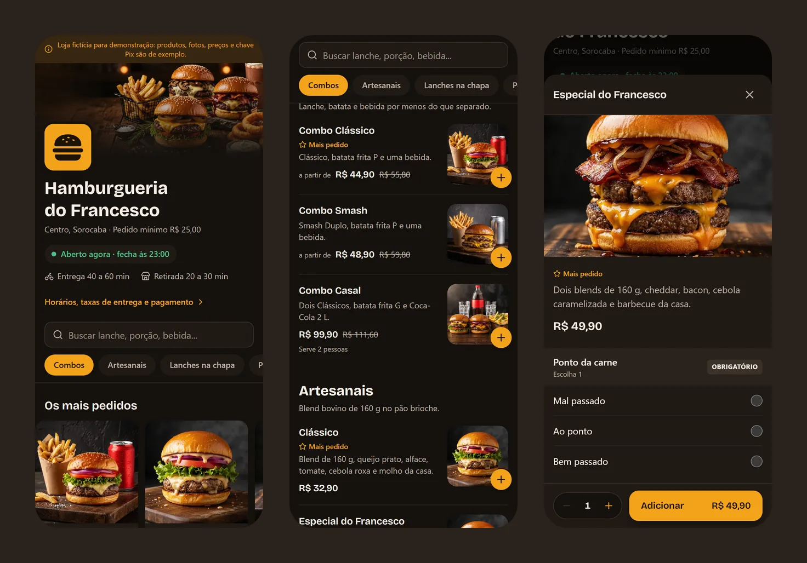

# Cardápio digital com pedido pelo WhatsApp

Cardápio para lanchonete e hamburgueria que monta o pedido completo no celular do cliente e
entrega pronto no WhatsApp da loja: itens com opções, taxa do bairro, forma de pagamento,
troco e, no Pix, o código "copia e cola" já com o valor do pedido.

**Demonstração:** [cardapio-gilt-ten.vercel.app](https://cardapio-gilt-ten.vercel.app). A
hamburgueria é fictícia, e os preços e a chave Pix são de exemplo. As fotos dos 26 produtos e a
capa foram geradas com o gerador de imagens do Canva e são ilustrativas; numa loja real, entram
as fotos dos pratos de verdade.



Fiz para o tipo de loja que hoje recebe pedido digitado à mão no WhatsApp e perde tempo
perguntando sabor, ponto da carne, bairro e troco. O site é estático, sem servidor e sem
mensalidade de plataforma: cada loja é um arquivo de configuração e um deploy.

## O que o cliente faz

- Navega por categorias fixas no topo, ou busca por palavra, sem precisar de acento.
- Abre um produto e escolhe as opções. Uma opção pode ser obrigatória, como o ponto da carne ou
  o tamanho, ou opcional com limite, como até 4 adicionais. O preço é atualizado a cada escolha.
- Escreve uma observação ("sem cebola") e a quantidade.
- Vê na sacola sugestões de acompanhamento e bebida que ainda não pediu.
- Escolhe entre entrega e retirada. Na entrega, o bairro define a taxa, e um bairro fora da
  lista fica com a taxa "a combinar".
- Paga com Pix, cartão na entrega ou dinheiro, com troco conferido contra o total.
- Envia. O WhatsApp abre com a mensagem formatada, e o Pix aparece com QR Code e botão de
  copiar.
- Na próxima visita, encontra a sacola e o endereço preenchidos e pode repetir o último pedido.

Detalhes que fazem diferença no uso:

- **Horário no fuso da loja.** O status "Aberto agora · fecha às 23:00" ou "Fechado · abre
  sexta às 18:00" usa o horário de Brasília, não o relógio do celular. Faixas que passam da
  meia-noite (18:00 às 00:30) funcionam.
- **Voltar do celular fecha o painel.** Produto, sacola e informações da loja ficam no endereço
  (`#produto/smash-duplo`), então o botão voltar fecha o painel em vez de sair do site, e dá
  para divulgar o link de um produto específico.
- **Prévia do link.** Ao colar o endereço no WhatsApp ou no Instagram, aparece a imagem
  `public/img/compartilhar.jpg` com nome e descrição. As metatags saem prontas no HTML do
  build, porque os robôs de prévia não executam JavaScript.
- **Fotos leves.** Cada foto existe em 400 e 800 px de largura, em WebP. A lista baixa a de
  400 e a ficha do produto, a de 800; a capa tem versões de 960 e 1920 px. A lista inteira
  com fotos pesa menos de 700 KB.

## Como o pedido chega na loja

```
*Pedido K7Q2* · Hamburgueria do Francesco

2x Clássico · R$ 75,80
   Ponto da carne: Ao ponto
   Adicionais: Bacon
   Obs.: sem cebola
1x Guaraná lata 350 ml · R$ 6,50

Subtotal: R$ 82,30
Entrega (Campolim): R$ 7,00
*Total: R$ 89,30*

*Entrega*
Nome: Ana
Endereço: Rua das Flores, 123
Bairro: Campolim

*Pagamento:* Pix (código gerado no cardápio). Envio o comprovante nesta conversa.
```

O código de 4 caracteres (sem 0, O, 1 e I, que se confundem) identifica o pedido na
conversa e vai como identificador da transação no Pix.

## Montar o cardápio de outra loja

Tudo o que muda de uma loja para outra está em [`src/dados/loja.ts`](src/dados/loja.ts) e nas
fotos de `public/img`: nome, WhatsApp, horários, bairros e taxas, formas de pagamento, chave
Pix, cor da marca, categorias, produtos e opções. O passo a passo está em
[docs/nova-loja.md](docs/nova-loja.md).

A configuração é conferida pelos testes antes de qualquer deploy. O build falha se houver:

- ids repetidos ou produto em categoria que não existe;
- preço quebrado ou "preço anterior" menor que o atual;
- grupo de opções com mínimo maior que o máximo;
- foto que não existe ou produto com foto sem texto alternativo;
- horário fora do formato `HH:MM`;
- WhatsApp sem DDI ou chave Pix em formato inválido.

## Pix

O código segue o BR Code do Banco Central para QR Code estático
([Manual de Padrões para Iniciação do Pix](https://www.bcb.gov.br/content/estabilidadefinanceira/pix/Regulamento_Pix/II_ManualdePadroesparaIniciacaodoPix.pdf),
seção 2.6). Os testes reproduzem, caractere por caractere, os dois exemplos do manual,
inclusive o CRC16 calculado com o "6304" incluído.

O código estático não avisa a loja de que o pagamento caiu: a confirmação continua sendo o
comprovante na conversa ou o extrato. Confirmação automática exige Pix dinâmico, que depende
de conta e API de um banco ou de um intermediador de pagamento.

## Como está feito

```
src/dados/loja.ts        configuração da loja (o único arquivo que muda por cliente)
src/dominio/             regras sem interface: preço, sacola, horário, pedido, Pix, busca
src/componentes/         interface em Preact
tests/                   Vitest: regras e conferência da configuração
e2e/                     Playwright: o pedido inteiro no celular e no desktop
vercel.json              build e cabeçalhos de segurança
```

- **Valores em centavos.** Todo cálculo é com inteiros; a formatação em reais só acontece na
  hora de mostrar.
- **O preço nunca vem do navegador.** A sacola salva guarda só produto, opções e quantidade. Ao
  abrir o site, cada item é conferido contra o cardápio atual. Item que saiu do cardápio ou
  opção que não existe mais é descartado, e o preço é sempre recalculado.
- **Preact em vez de React.** É a mesma forma de escrever componentes, com menos código para o
  celular baixar. O JavaScript inteiro tem cerca de 30 kB comprimido.
- **Fonte no próprio site.** A Bricolage Grotesque vem do pacote Fontsource, sem chamada ao
  Google Fonts. Os testes de ponta a ponta falham se a página fizer qualquer requisição
  externa.
- **Política de segurança restrita.** O `vercel.json` só permite scripts, estilos, fontes e
  imagens do próprio domínio, e o `vite preview` usa os mesmos cabeçalhos. Assim os testes de
  navegador rodam sob a política de produção e falham com qualquer violação no console.
- **Janelas com `<dialog>`.** O navegador cuida do foco, da tecla Esc e de esconder o fundo dos
  leitores de tela.

## Rodando

Precisa do Node 24.

```bash
npm install
npm run dev
```

```bash
npm test            # regras e configuração (Vitest)
npm run test:e2e    # pedido completo em Chromium, celular e desktop (Playwright)
npm run build       # verifica os tipos e gera dist/
```

Na primeira vez, `npx playwright install chromium` baixa o navegador dos testes. Com o Chrome
instalado, `PW_CHANNEL=chrome npm run test:e2e` usa ele.

A integração contínua roda tipos, testes de unidade, build e os testes de ponta a ponta a cada
push e pull request.

## Limitações

- **Sem painel da loja.** Produtos e preços mudam no arquivo de configuração e num novo
  deploy. Para a loja editar sozinha, o próximo passo é um painel com banco de dados.
- **O pedido depende do cliente tocar em enviar.** O site monta a mensagem e abre o WhatsApp,
  mas não tem como saber se ela foi enviada.
- **Sem cupom de desconto.** Num site estático, qualquer código de cupom fica visível no
  código-fonte. Desconto, por enquanto, a loja aplica na conversa.
- **Taxa por bairro, não por distância.** Calcular por distância exige geolocalização do
  endereço, que depende de um serviço pago de mapas.
- **Fotos geradas.** As fotos da demonstração não mostram pratos de uma cozinha real. Produto
  sem foto continua funcionando: aparece em lista, sem espaço vazio.
- **Aviso do `npm audit`.** O `picomatch`, usado pelo Vite e pelo Vitest para ler padrões de
  arquivo durante o desenvolvimento, tem um alerta de ReDoS
  ([GHSA-fc5q-39xc-vjpf](https://github.com/advisories/GHSA-fc5q-39xc-vjpf)) ainda sem versão
  corrigida. Ele não vai para o site publicado e só recebe padrões escritos por mim.
